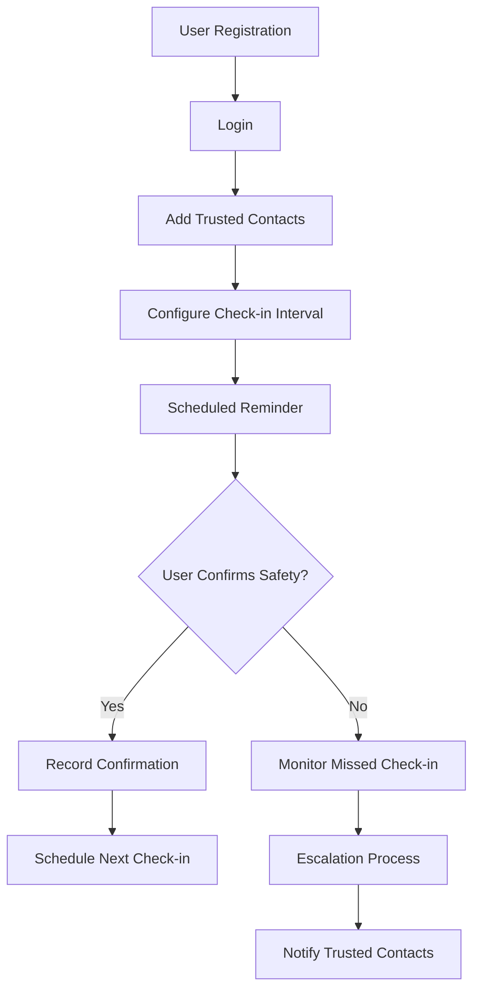

# LastSignal – Automated Safety Check-in System

A Java-based automated safety check-in system that helps people living alone, travelling alone, or working remotely stay connected with their trusted contacts.

LastSignal allows users to configure periodic safety check-ins. The system sends reminder emails, records user confirmations, and automatically notifies selected trusted contacts when a user misses a scheduled check-in.

**Built with Java, JSP, Jakarta Servlets, JDBC, Apache Derby, Jakarta Mail, and GlassFish.**

---
## Overview

LastSignal is an automated safety check-in web application designed to provide an additional layer of reassurance for people who may spend time alone.

Users can create an account, add trusted contacts, and configure how frequently they want to check in. The application automatically manages reminder notifications and monitors whether users confirm their safety within the configured time.

If a user does not respond within the expected period, LastSignal initiates an email-based escalation process to notify their selected trusted contacts.

The project demonstrates how Java enterprise technologies can be combined to build a practical, database-driven web application with scheduled background processing, email communication, session management, and security controls.

## Problem Statement

People living alone, travelling independently, or working remotely may sometimes be unable to communicate when an unexpected situation occurs.

In many cases, family members or friends may not immediately know that someone has missed their usual communication routine.

Traditional safety applications often depend on users manually contacting someone or continuously sharing their location.

LastSignal addresses this problem through an automated check-in mechanism. It allows users to establish a check-in routine and designate trusted contacts who can be notified if a scheduled confirmation is missed.

The system is intended as an additional communication and awareness tool, not as a replacement for emergency services.

## Key Features

| Feature | Description |
|---|---|
| User Registration | Allows new users to create an account. |
| Secure Login | Authenticates users before granting access to protected pages. |
| User Dashboard | Provides access to check-in information and application features. |
| Trusted Contacts | Allows users to add and manage people who should receive alerts. |
| Check-in Settings | Allows users to configure their preferred check-in interval. |
| Email Reminders | Sends automated reminders asking users to confirm their safety. |
| Safety Confirmation | Allows users to confirm that they are safe through a secure email confirmation link. |
| Missed Check-in Monitoring | Background tasks monitor pending check-ins. |
| Email Escalation | Notifies selected trusted contacts when a check-in is missed. |
| Session Management | Manages authenticated user sessions and logout. |
| Notification Management | Records and manages notification-related information. |

## How It Works

The application follows a simple automated workflow:

1. **Register:** The user creates an account.
2. **Add Trusted Contacts:** The user adds contacts who can be notified if a check-in is missed.
3. **Configure Check-in:** The user selects their preferred check-in interval.
4. **Receive Reminder:** The application sends an email reminder when a check-in is due.
5. **Confirm Safety:** The user follows the confirmation link to confirm that they are safe.
6. **Monitor Response:** The background monitoring service checks whether the user has responded within the expected time.
7. **Send Alert:** If the check-in is missed, the escalation process sends email notifications to the selected trusted contacts.

### Workflow Diagram



## Technology Stack

| Technology | Purpose |
|---|---|
| Java 21 | Core application development and business logic. |
| JSP | Dynamic web page development. |
| Jakarta Servlets | Handles HTTP requests and application workflows. |
| JDBC | Database connectivity and SQL operations. |
| Apache Derby | Relational database management. |
| Jakarta Mail | Email reminders and alert notifications. |
| JavaBeans | Represents application data and model objects. |
| HTML5 | Web page structure. |
| CSS3 | Application styling and layout. |
| JavaScript | Client-side interactions and validation. |
| ScheduledExecutorService | Executes scheduled background monitoring tasks. |
| GlassFish 8.0.0 | Jakarta EE application server. |
| Apache NetBeans 30 | Development environment. |
| Apache Ant | Project build and deployment automation. |
| Git and GitHub | Version control and source code hosting. |

## System Architecture

LastSignal follows a modular, layered architecture to separate application responsibilities.

| Layer | Responsibility |
|---|---|
| Presentation Layer | JSP pages provide the user interface. |
| Controller Layer | Servlets handle incoming requests and coordinate application operations. |
| Service Layer | Contains business logic for users, contacts, check-ins, notifications, and escalation. |
| DAO Layer | Performs database operations using JDBC. |
| Model Layer | JavaBeans represent application entities and data. |
| Utility Layer | Provides database, validation, password, token, CSRF, and other reusable utilities. |
| Scheduler Layer | Manages scheduled check-in monitoring and escalation tasks. |
| Email Layer | Handles email delivery, templates, and email worker operations. |
| Filter Layer | Protects application resources through authentication checks. |
| Listener Layer | Handles application and session lifecycle events. |

## Project Structure

```text
LastSignal/
│
├── src/
│   ├── conf/
│   │   └── MANIFEST.MF
│   │
│   └── java/
│       ├── controller/
│       │   ├── CheckInServlet.java
│       │   ├── ContactServlet.java
│       │   ├── DashboardServlet.java
│       │   ├── EmailConfirmationServlet.java
│       │   ├── LoginServlet.java
│       │   ├── LogoutServlet.java
│       │   ├── RegisterServlet.java
│       │   └── SettingsServlet.java
│       │
│       ├── dao/
│       │   ├── ActionTokenDAO.java
│       │   ├── CheckInDAO.java
│       │   ├── CheckInSettingsDAO.java
│       │   ├── ContactDAO.java
│       │   ├── NotificationDAO.java
│       │   └── UserDAO.java
│       │
│       ├── email/
│       │   ├── EmailService.java
│       │   ├── EmailTemplates.java
│       │   └── EmailWorkerService.java
│       │
│       ├── filter/
│       │   └── AuthenticationFilter.java
│       │
│       ├── listener/
│       │   ├── ApplicationListener.java
│       │   └── SessionListener.java
│       │
│       ├── model/
│       │   ├── ActionTokenBean.java
│       │   ├── CheckInBean.java
│       │   ├── CheckInSettingsBean.java
│       │   ├── ContactBean.java
│       │   ├── NotificationBean.java
│       │   └── UserBean.java
│       │
│       ├── scheduler/
│       │   ├── CheckInMonitorTask.java
│       │   ├── EscalationTask.java
│       │   └── SchedulerService.java
│       │
│       ├── service/
│       │   ├── CheckInService.java
│       │   ├── CheckInSettingsService.java
│       │   ├── ContactService.java
│       │   ├── EmailConfirmationService.java
│       │   ├── EscalationService.java
│       │   ├── NotificationService.java
│       │   ├── UserService.java
│       │   └── ...
│       │
│       └── util/
│           ├── AuthRateLimiter.java
│           ├── CsrfUtil.java
│           ├── DBConnection.java
│           ├── DateTimeUtil.java
│           ├── HtmlUtil.java
│           ├── PasswordUtil.java
│           ├── TokenUtil.java
│           └── ValidationUtil.java
│
├── web/
│   ├── index.html
│   ├── login.jsp
│   ├── register.jsp
│   ├── dashboard.jsp
│   ├── contacts.jsp
│   ├── settings.jsp
│   ├── checkin.jsp
│   │
│   ├── css/
│   │   └── style.css
│   │
│   ├── js/
│   │   └── app.js
│   │
│   └── WEB-INF/
│       ├── web.xml
│       ├── glassfish-web.xml
│       └── lib/
│           ├── derbyclient.jar
│           └── derbyshared.jar
│
├── nbproject/
├── .env.example
├── .gitignore
└── build.xml
```

## Prerequisites

Install the following software before running the application:

| Software | Version |
|---|---|
| Java Development Kit | JDK 21 |
| Apache NetBeans | 30 |
| GlassFish Server | 8.0.0 |
| Apache Derby | Compatible Derby Network Server installation |
| Git | Latest stable version (optional) |

You also need:

- A working internet connection for email delivery.
- An SMTP-enabled email account.
- An application-specific email password or SMTP credentials.
- Sufficient permissions to configure the GlassFish server and database.

## Getting Started

Follow these instructions to run LastSignal locally after downloading or cloning the repository.

### Step 1: Download the Project

Clone the repository:

```bash
git clone https://github.com/Kriishapatel16/LastSignal.git
```

Alternatively, download the repository as a ZIP file from GitHub and extract it.

### Step 2: Open the Project in NetBeans

1. Open Apache NetBeans.
2. Select **File → Open Project**.
3. Browse to the extracted `LastSignal` folder.
4. Select the project and click **Open Project**.
5. Wait for NetBeans to load the Ant project.

Make sure the project is recognized as a Java Web Application.

### Step 3: Configure Java and GlassFish

1. Open **Tools → Java Platforms** in NetBeans.
2. Verify that JDK 21 is configured.
3. Open the Services window.
4. Expand **Servers**.
5. Add or select GlassFish Server 8.0.0.
6. Configure its installation directory and domain.
7. Start the GlassFish server.

### Step 4: Configure Apache Derby

LastSignal uses Apache Derby as its relational database.

1. Install or configure Apache Derby.
2. Start the Derby Network Server.
3. Ensure the server is listening on port `1527`.
4. Create or connect to the database named `LastSignalDB`.

The database connection URL used by the application is:

```text
jdbc:derby://localhost:1527/LastSignalDB;create=true
```

**Important database setup note:** The application requires its tables and constraints to be created before the features can work. The repository currently does not include a database schema export or automatic database migration script. You must provision the database schema to match the SQL statements used by the DAO classes before registering or using the application.

### Step 5: Configure the GlassFish JDBC Resource

The application obtains its database connection through a GlassFish JNDI DataSource.

The configured resource name is:

```text
jdbc/LastSignalDB
```

Configure the following in the GlassFish Administration Console:

1. Open the GlassFish Administration Console.
2. Navigate to **Resources → JDBC → JDBC Connection Pools**.
3. Create a connection pool using the Apache Derby client driver.
4. Configure the database connection URL, username, and password according to your Derby installation.
5. Save the connection pool.
6. Test the connection pool.
7. Navigate to **Resources → JDBC → JDBC Resources**.
8. Create a JDBC resource with the JNDI name:

```text
jdbc/LastSignalDB
```

9. Associate it with the connection pool created earlier.
10. Save the resource and restart the server if required.

Ensure the Derby JDBC driver is available to GlassFish. If the server cannot load the driver, configure the Derby client JAR on the GlassFish server classpath and restart the server.

### Step 6: Configure Email Credentials

LastSignal uses SMTP through Jakarta Mail to send reminders and notifications.

The project includes a `.env.example` file containing the required configuration variable names.

Create the following environment variables on your system:

```text
LASTSIGNAL_SMTP_HOST=smtp.example.com
LASTSIGNAL_SMTP_USERNAME=your-email@example.com
LASTSIGNAL_SMTP_PASSWORD=your-app-password
LASTSIGNAL_SMTP_FROM=your-email@example.com
LASTSIGNAL_SMTP_PORT=587
LASTSIGNAL_SMTP_SSL=false
LASTSIGNAL_SMTP_STARTTLS=true
```

Replace the example values with your actual SMTP provider details.

For example, when using Gmail SMTP, the host is commonly `smtp.gmail.com` and the port is `587` with STARTTLS enabled. Use an App Password where required, rather than your normal account password.

**Important:**

- Set these as operating-system environment variables before starting NetBeans and GlassFish.
- Restart NetBeans and the GlassFish server after setting or changing them so the server process can read the updated values.
- The application reads environment variables; the `.env.example` file is a configuration reference and is not automatically loaded by Java.
- Never commit actual email credentials or passwords to GitHub.

### Step 7: Build the Project

In NetBeans:

1. Right-click the `LastSignal` project.
2. Select **Clean and Build**.
3. Wait for the build to complete.
4. Resolve any missing server or library configuration before deployment.

The project uses Apache Ant through its `build.xml` configuration.

### Step 8: Run the Application

1. Ensure Derby Network Server is running.
2. Ensure the GlassFish JDBC resource is configured and available.
3. Ensure SMTP environment variables are configured.
4. Ensure the database schema has been created.
5. Right-click the project in NetBeans.
6. Select **Run**.

NetBeans will build and deploy the application to GlassFish.

Open the application using the URL shown in the NetBeans deployment output. The default URL will generally follow this format:

```text
http://localhost:8080/LastSignal/
```

The context path may differ depending on the project configuration.

You can now register a user and explore the application.

## Application Modules

### 1. User Management

Handles user registration, login, authentication, and account-related operations.

### 2. Trusted Contact Management

Allows users to add, update, and manage their trusted contacts. Contact operations are restricted to the authenticated user's own records.

### 3. Check-in Management

Manages safety check-in records and user confirmation operations.

### 4. Check-in Settings

Stores and manages the user's configured check-in interval.

### 5. Email Notification

Uses Jakarta Mail to send check-in reminders and notification emails.

### 6. Email Confirmation

Processes secure confirmation links so users can confirm their safety through email.

### 7. Scheduled Monitoring

Uses Java's `ScheduledExecutorService` to run background monitoring tasks without requiring users to keep the application page open.

### 8. Escalation Management

Handles missed check-in processing and sends alerts to the user's selected trusted contacts.

## Security Features

Security is an important part of LastSignal's implementation.

The application includes:

- Password hashing through a dedicated password utility.
- Prepared SQL statements to help prevent SQL injection.
- Session-based authentication.
- Authentication filters for protected resources.
- CSRF token validation for protected state-changing operations.
- Authentication rate limiting.
- Secure token generation and validation for email confirmation.
- User ownership checks for trusted-contact operations.
- Input validation and output encoding utilities.
- Environment-based email credential configuration.
- Controlled error handling to avoid exposing unnecessary internal details.

## Testing

The project includes module-level test classes for selected operations.

Examples include:

- `DBConnectionTest`
- `UserModuleTest`
- `ContactModuleTest`

These can help verify database connectivity, user operations, and trusted-contact functionality during development.

For an end-to-end test, follow this sequence:

1. Start Derby and GlassFish.
2. Confirm the JDBC resource connection.
3. Register a new user.
4. Log in with the registered credentials.
5. Add a trusted contact.
6. Configure the check-in interval.
7. Verify that the reminder email is delivered.
8. Open the confirmation link and verify that the check-in is recorded.
9. Test the missed check-in workflow and verify that the configured trusted contacts receive the appropriate alert.

Use test email accounts and contacts when validating notification and escalation behavior.

## Limitations and Future Enhancements

LastSignal is designed as an email-based safety check-in system. It does not currently provide emergency-service integration or real-time location tracking.

Possible future enhancements include:

- SMS and mobile push notifications.
- Mobile application support.
- Location-sharing integration with user consent.
- Additional notification channels.
- More configurable escalation rules.
- Detailed activity and notification history.
- Database schema migration and automated setup scripts.
- Automated integration testing.

## Contributing

Contributions and suggestions are welcome.

If you want to improve the project:

1. Fork the repository.
2. Create a new branch for your changes.
3. Make your changes and test them.
4. Commit your changes with a meaningful commit message.
5. Open a Pull Request describing your contribution.

Please avoid committing passwords, SMTP credentials, personal information, or other sensitive configuration.

## Author

**Krisha Patel**

Java Developer | Software Development | Web Applications

GitHub: [@Kriishapatel16](https://github.com/Kriishapatel16)

---

## License

No license has currently been specified for this repository. All rights are reserved unless a license is added by the author.

---

**LastSignal – Because every check-in matters.**
